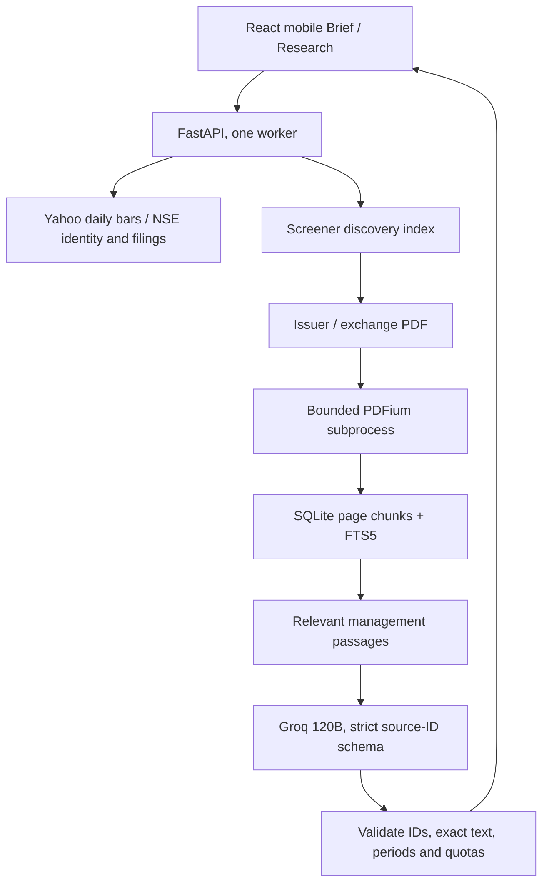

# FINN — implemented architecture

15 November 2026. [Planning decisions](docs/FINN_ARCHITECTURE.md) are retained separately; this describes the deployed application.

One Render Free Python 3.12.14 service serves the Vite build and API. SQLite and downloaded PDFs are disposable caches. A dated, labelled seed preserves three real-pipeline examples and a filing snapshot; current coverage refreshes independently. Browser storage retains review acknowledgements and one saved answer. There is no account or cross-device synchronisation.

**Brief:** 15 fixed holdings; priority is explainable and conservative. Only positively assessed routine disclosures collapse. Missing extraction stays pending, every fetched filing remains reachable, and source coverage is separate from importance. Opening evidence never acknowledges it. Revision identity follows source metadata and observed PDF bytes, not assessment TTL or parser version. Mark reviewed and Undo handle late responses without swallowing new revisions.

**Research:** resolve the official NSE issuer/ISIN, discover report and call links, validate the issuer/document/period, then extract page-local chunks. Screener is a discovery index, never cited evidence. FTS5 and small topical reservations select context. The model selects supplied management passage IDs; the server displays exact attributable wording, retaining adjacent qualifications. Model paraphrases are not accepted as factual assertions. Broad retrieval can return an explicitly partial answer.

**Provenance:** citation IDs include byte hash, parser version, document kind, PDF page and chunk. Answer caches invalidate when known document versions change. Unknown IDs, wrong pages and invented quotes fail validation. An evicted version returns HTTP410; the browser keeps the captured excerpt and warns that the original URL may now contain a newer document. This is not permanent PDF archiving.

**Limits:** HTTPS fetches validate public IPs and pin the connection, Host and TLS SNI; bounded redirects and no environment proxy. PDF ingestion is serial with one waiting request, 40 MB / 500 pages / 180 seconds, six million extracted characters, Linux child address-space cap 350 MB and sampled combined RSS guard 440 MB. PDFium handles reopen every 32 pages; the workaround was checked against all extracted pages. OCR is excluded.

**Provider:** Groq `openai/gpt-oss-120b`, free tier. One flight per minute, at most 7,600 reserved tokens per request including schema/output, and a conservative 180,000-token / 900-request UTC-day ledger. Restart waits a minute; model ledgers remain separate. Known daily seed baselines restore by maximum. Uncheckpointed usage can be lost with Render's filesystem, so the provider's hard free limits remain the backstop. No paid routing. Gemini billing-disabled status is user-confirmed, but account limits are unverified and automatic fallback is disabled.

**Numbers:** Decimal handles EOD change, preceding-20-session volume ratios and supported narrative unit conversions. Quarter versus half-year comparisons are refused; unknown accounting scope is disclosed. The model never supplies arithmetic operands from memory.

**Failures:** explicit stale/partial/unavailable coverage, bounded jobs, retained loaded sources on generation failure, expired-job recovery and request-generation guards. Source availability, PDF extraction and universal ticker coverage are not guaranteed. Price access is not a redistribution licence.

**Dependencies:** FastAPI, HTTPX, Pydantic, PDFium, SQLite FTS5, React/Vite and a selectively adapted Radix/shadcn sheet. No Docling, LlamaIndex, Instructor, vector service, Redis, yfinance wrapper or GPL NSE wrapper. [Licences](THIRD_PARTY_NOTICES.md) and [fork review](docs/FINN_COMPONENT_REVIEW.md).

**Verification:** [test commands](TESTING.md), [research audit](docs/EVIDENCE_AUDIT.md), [QA/design review](docs/QA_REVIEW.md), [measured hosting gate](docs/FEASIBILITY_RESULTS.md). Live requests, cached replays and controlled fixtures are distinguished. Durable cache/quota storage and investor prioritisation feedback are next; deferred product features remain excluded.
